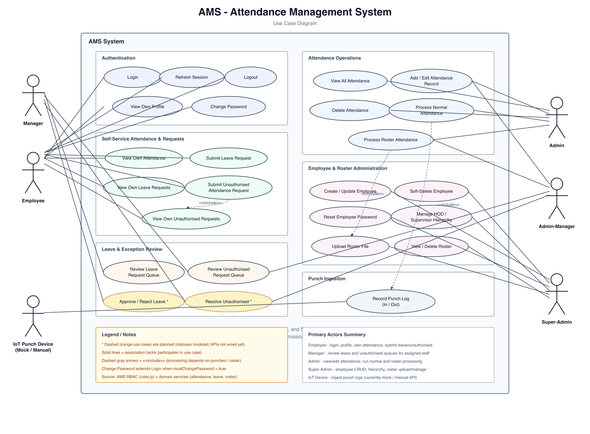

# AMS — Attendance Management System

Workforce attendance platform for employees, shift rosters, punch logs, daily attendance processing, and leave / unauthorised exception workflows.

## Use case diagram



## Tech stack

| Layer | Technology |
|--------|------------|
| Frontend | Next.js 16, React 19, TypeScript, MUI, Axios |
| Backend | Express 5, Sequelize 6, Node.js |
| Database | Neon Postgres |
| Auth | Encrypted JWT (JWE) + HttpOnly rotating refresh cookie |

## Repository layout

```
AMS/
├── ams-backend/     # Express API (port 5000)
├── ams-frontend/    # Next.js UI (port 3000)
└── docs/diagrams/   # Architecture / UML diagrams
```

## Core domains

1. **Employees & hierarchy** — master data, roles, HOD / supervisor tree, soft-delete  
2. **Auth & sessions** — login, refresh, logout, forced password change  
3. **Rosters** — CSV / XLSX shift upload for rostered staff  
4. **Punch logs** — in/out events (IoT mock UI or manual API)  
5. **Attendance** — daily processed status (normal fixed shift vs roster shifts)  
6. **Leave & unauthorised requests** — employee submit + manager review queues  

### Dual attendance engines

| Mode | Employees | Shift source | Rules |
|------|-----------|--------------|--------|
| Normal | `roster = false` | Fixed 08:30–17:00 | Worked minutes → full day / short leave / half day / unauthorised |
| Roster | `roster = true` | Uploaded roster rows | Late arrival extends required clock-out (`lateCoverMinutes`) |

## Roles (RBAC)

| Role | Capabilities |
|------|----------------|
| `employee` | Login, profile, own attendance, submit leave / unauthorised |
| `manager` | Review leave & unauthorised queues for assigned staff |
| `admin` | View / edit attendance; run normal & roster processing |
| `admin-manager` | Admin attendance permissions + manager leave review |
| `super-admin` | Employee CRUD, hierarchy, roster upload / manage |

Permission groups live in `ams-backend/config/roles.js` and are mirrored in `ams-frontend/app/lib/roles.ts`.

## Getting started

### Prerequisites

- Node.js 20+
- A Neon Postgres database (or any Postgres URL compatible with Sequelize)

### Backend

```bash
cd ams-backend
cp env-sample .env
# Edit .env: set DATABASE_URL, JWT_ENCRYPTION_KEY, REFRESH_TOKEN_PEPPER
npm install
npm run migrate   # optional SQL migrations
npm run dev       # http://localhost:5000
```

Generate a JWT encryption key:

```bash
node -e "console.log(require('crypto').randomBytes(32).toString('base64url'))"
```

> On macOS, AirPlay Receiver may occupy port **5000**. If the API cannot bind, set `PORT=5001` in `ams-backend/.env` and point the frontend `BACKEND_URL` at the same port.

### Frontend

```bash
cd ams-frontend
cp env-sample .env.local
# BACKEND_URL=http://localhost:5000  (or 5001 if you changed the API port)
npm install
npm run dev       # http://localhost:3000
```

In local dev, Next.js rewrites proxy API paths (`/auth`, `/employee`, `/roster`, `/attendance`, etc.) to the backend so the browser can call same-origin URLs.

### Tests (backend)

```bash
cd ams-backend
npm test
```

## Main API surface

| Prefix | Purpose |
|--------|---------|
| `/auth` | Login, refresh, logout, me, profile, change password |
| `/employee` | Employee CRUD & hierarchy (super-admin) |
| `/roster` | Roster upload, view, delete, process |
| `/attendance-log` | Create punch logs |
| `/attendance` | Process + CRUD daily attendance |
| `/leave` | Submit / list leave requests |
| `/unauthorised` | Submit / list unauthorised attendance requests |

## Known gaps

- Leave **approve / reject / cancel** APIs are not wired yet (statuses are modeled).  
- Unauthorised **resolve** service exists but is not exposed on HTTP routes.  
- IoT punch devices are mocked; no live device sync in-repo.  
- Attendance processing is on-demand (no background jobs / cron).

## License

ISC (backend package default).
